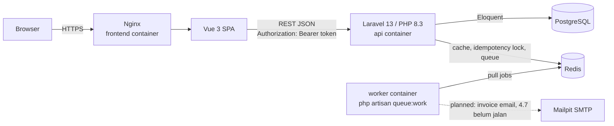
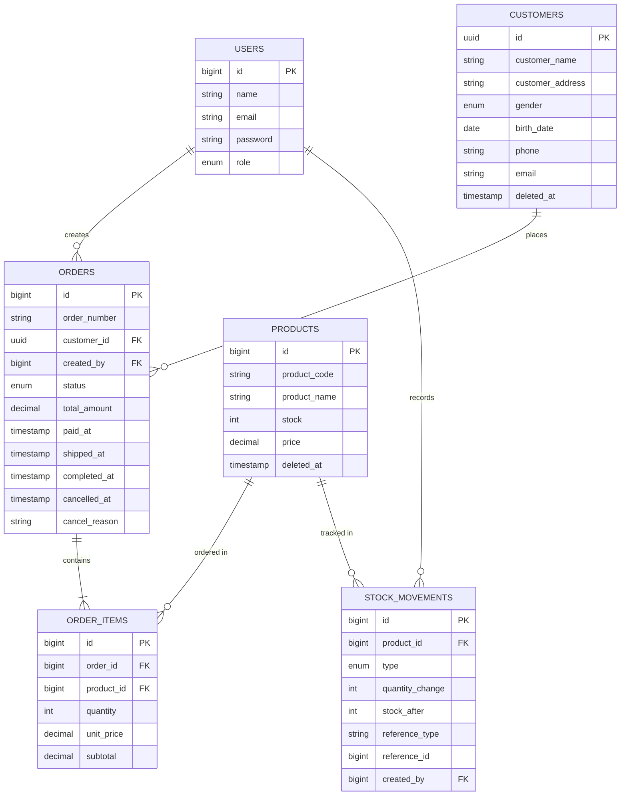

# Architecture

## Diagram

## Entity Relationship Diagram

## Struktur Layer

- `app/Http/Controllers` — tipis, cuma delegasiin ke Form Request (validasi+otorisasi) dan Service, balikin JSON lewat API Resource. Gak ada business logic di sini.
- `app/Http/Requests` — validasi input + otorisasi per endpoint lewat `authorize()` yang manggil Policy.
- `app/Http/Resources` — bentuk response API, dipisah dari struktur Eloquent model biar perubahan kolom DB gak otomatis ngubah kontrak API.
- `app/Policies` — RBAC admin vs cashier, ditegakkan di backend (bukan cuma disembunyiin di UI), sesuai requirement 4.6.
- `app/Domain/Order/OrderStateMachine` — logic transisi status order murni (gak nyentuh DB/HTTP), dipake `OrderTransitionService`. Dipisah dari Eloquent biar aturan transisi gak keulang jadi if-chain di beberapa tempat.
- `app/Services/Order/{OrderCreationService,OrderTransitionService}` — orkestrasi transaction, locking, dan penulisan ledger stok. Ini layer "business logic" sesungguhnya, di antara controller yang tipis dan domain/model.
- `app/Http/Middleware/EnsureIdempotentOrderRequest` — cross-cutting concern buat idempotency, sengaja dipisah dari controller/service biar gampang dicabut/diuji sendiri.
- `app/Models` — Eloquent + relasi + cast, termasuk `OrderStatus` sebagai backed PHP enum di kolom `status` buat type-safety.
- `app/Enums`, `app/Exceptions` — `InvalidOrderTransitionException` (render sendiri jadi 409) dan `InsufficientStockException` (jadi 422) biar bentuk error konsisten tanpa diulang di tiap controller.

## ADR

### ADR-1: Strategi Konsistensi Stok & Order

**Konteks**: Banyak kasir bisa bikin/cancel/transisi order yang nyentuh produk yang sama secara bersamaan. Sistem gak boleh oversell, dan dua transisi status yang konflik (misal `pay` & `cancel` nyaris bareng) gak boleh dua-duanya kejalanin.

**Opsi dipertimbangkan**:
1. Pessimistic locking (`SELECT ... FOR UPDATE`) dalam DB transaction.
2. Optimistic locking (kolom `version` + retry on conflict).
3. Atomic conditional update (`UPDATE products SET stock = stock - ? WHERE id = ? AND stock >= ?`, cek affected rows).

**Keputusan**: Pessimistic locking, diterapkan di dua level:
- **Produk** — saat create/cancel order, row produk di-lock (`lockForUpdate()`) di dalam `DB::transaction()`, diurutin by `product_id` ascending dulu sebelum di-lock supaya order multi-item yang rebutan produk yang sama gak saling deadlock (selalu ngambil lock dalam urutan yang sama).
- **Order** — tiap method transisi (`markAsPaid/markAsShipped/markAsCompleted/cancel`) re-fetch row order yang sama pake `lockForUpdate()` di awal transaction, dan state-check (`assertCanTransition`) jalan ke hasil fetch yang udah ter-lock itu, bukan ke objek order yang di-resolve route-model-binding sebelum lock diambil. Ini nutup race antara dua transisi yang nembak order yang sama hampir bersamaan.

**Konsekuensi**: Correctness dijamin di level DB, logic-nya simpel buat dinalar. Ada lock-wait latency di produk yang lagi hot, tapi masih wajar buat skala jumlah kasir yang diasumsikan soal ini (lihat bagian scaling di bawah buat skala lebih gede). Harus dites terhadap DB beneran (Postgres), bukan SQLite in-memory, karena semantik locking-nya beda — dibuktikan lewat `OrderConcurrencyTest` (20 request paralel, stok 5 → tepat 5 sukses/15 gagal) dan `OrderCancelConcurrencyTest` (10 cancel paralel ke order yang sama → tepat 1 sukses/9 ditolak 409), keduanya nembak HTTP beneran via `Http::pool()` ke server multi-worker (`php artisan serve --no-reload` + `PHP_CLI_SERVER_WORKERS`), bukan test client in-process.

### ADR-2: Desain Idempotency Pembuatan Order

**Konteks**: `POST /api/orders` harus aman di-retry client yang flaky (koneksi putus, timeout) tanpa bikin order dobel / stok kepotong dua kali.

**Opsi dipertimbangkan**:
1. Tabel DB buat simpen idempotency key + response.
2. Redis (key → fingerprint + response) dengan TTL.
3. Gak ada idempotency, serah ke client buat dedup sendiri.

**Keputusan**: Redis, lewat middleware `EnsureIdempotentOrderRequest` yang nempel di `POST /orders`. Alurnya:
- Header `Idempotency-Key` (UUID) opsional — kalau gak dikirim, request diproses normal tanpa jaminan apa-apa.
- Key udah pernah dipake + body fingerprint (`sha256` dari raw request body) **sama** → balikin response yang udah tersimpan apa adanya, gak diproses ulang.
- Key udah pernah dipake + fingerprint **beda** → **409 Conflict** (dipilih daripada 422 karena ini konflik soal "key yang sama dipake buat maksud yang beda", bukan error validasi payload itu sendiri).
- Key lagi "in-flight" (request pertama pake key itu masih diproses) → diklaim pake `Cache::add()` (atomic SETNX di Redis) sebagai lock 30 detik; kalau gagal klaim → 409, biar dua request dengan key yang sama persis gak dua-duanya ikut diproses.
- Masa berlaku record: 24 jam.

**Konsekuensi**: Nambah dependency ke Redis (udah ada dependency wajib lain juga via docker-compose, jadi gak nambah beban baru). Lock in-flight di layer idempotency ini jadi pertahanan tambahan di luar `lockForUpdate()` di layer domain (ADR-1) — defense in depth, bukan pengganti.

### ADR-3: Strategi Autentikasi

**Konteks**: SPA (Vue, origin terpisah) perlu auth ke API Laravel yang juga origin terpisah, dua role (admin/cashier), butuh logout yang beneran revoke.

**Opsi dipertimbangkan**:
1. Sanctum mode SPA (cookie + CSRF, asumsi same-domain).
2. Sanctum personal access token (Bearer).
3. Passport/OAuth2 penuh.
4. JWT custom (access+refresh, kayak Track A).

**Keputusan**: Sanctum personal access token (Bearer), bukan mode cookie SPA-nya Sanctum — karena FE & BE beneran dua service/origin terpisah (bukan asumsi same-domain yang dipakai mode cookie Sanctum), dan soal eksplisit minta "Sanctum token dengan expiry dan revoke saat logout" buat Track B (bukan refresh-token rotation yang itu spesifik buat Track A/JWT). Login bikin token lewat `createToken(..., expiration: now()->addHours(24))`, FE nyimpen & ngirim `Authorization: Bearer <token>`, logout manggil `currentAccessToken()->delete()`.

**Konsekuensi**: Gak ada silent refresh — token kedaluwarsa abis 24 jam, FE harus paksa login ulang pas dapet 401 (lebih simpel dari refresh-rotation, tapi sesi gak bisa diperpanjang diem-diem). Karena ini API cross-origin beneran (bukan cookie same-site), CORS wajib dikonfigurasi eksplisit ke origin frontend — masih jadi item TODO (lihat README).

## Skala 50.000 Order/Hari dari Banyak Cabang

Yang bakal diubah kalau beban naik ke skala itu (~35 order/menit rata-rata, jauh lebih padat pas jam ramai):

- **Row-level lock di produk jadi bottleneck** kalau satu produk populer dibeli dari banyak cabang sekaligus. Ganti ke atomic conditional update (`UPDATE ... WHERE stock >= ? RETURNING`) buat ngurangin durasi lock, atau pindahin reservasi stok ke counter atomic di Redis (Luar script buat cek-dan-kurangin) di depan Postgres, dengan rekonsiliasi berkala — trade-off: consistency sedikit lebih eventual demi throughput.
- **Background job jadi wajib dipisah dari request cycle** sepenuhnya (bukan `sync`), pake queue worker yang discale horizontal (Laravel Horizon) biar latency request gak kebawa beban job invoice/notifikasi.
- **Read replica Postgres** buat endpoint yang read-heavy (`GET /orders`, `/reports/*`), primary cuma buat write. Cache dashboard/report di Redis dengan invalidation eksplisit pas ada mutasi order (udah direncanain di 4.8), bukan dihitung ulang tiap request.
- **Tambah `branch_id`** ke skema (belum ada sekarang) buat beneran isolasi per cabang, buka peluang sharding/partisi tabel `orders` & `stock_movements` per bulan/cabang.
- **Redis Cluster** gantiin single Redis instance, biar idempotency store & cache gak jadi single point of failure.
- **Structured logging + request_id tracing (4.9)** jadi krusial buat debug lintas service di skala ini; tambah distributed tracing (OpenTelemetry) sesuai bagian bonus.