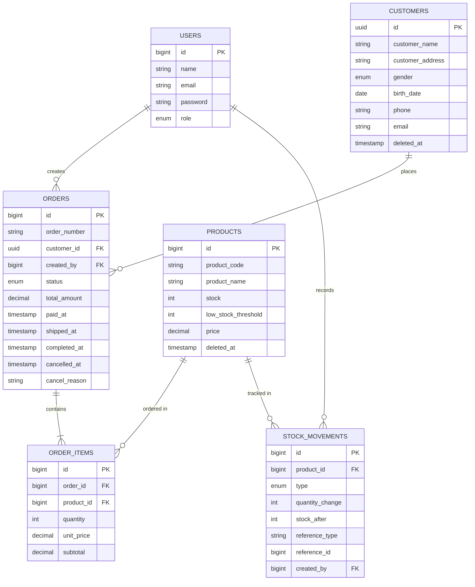

# Architecture

## Diagram

```mermaid
flowchart LR
    Browser -->|HTTPS| Nginx[Nginx\nfrontend container]
    Nginx --> VueApp[Vue 3 SPA]
    VueApp -->|REST JSON\nAuthorization: Bearer token| Laravel[Laravel 13 / PHP 8.3\napi container]
    Laravel -->|Eloquent| Postgres[(PostgreSQL)]
    Laravel -->|cache, idempotency lock, queue| Redis[(Redis)]
    Worker[worker container\nphp artisan queue:work] -->|pull jobs| Redis
    Worker -.->|rencana: invoice email (4.7) belum berjalan| Mailpit[Mailpit SMTP]
```

## Entity Relationship Diagram



## Struktur Layer

- `app/Http/Controllers` — ringan, hanya mendelegasikan ke Form Request (validasi dan otorisasi) dan Service, lalu mengembalikan JSON melalui API Resource. Tidak terdapat logika bisnis pada lapisan ini.
- `app/Http/Requests` — menangani validasi input dan otorisasi per endpoint melalui method `authorize()` yang memanggil Policy.
- `app/Http/Resources` — membentuk struktur response API, dipisahkan dari struktur model Eloquent agar perubahan kolom database tidak secara otomatis mengubah kontrak API.
- `app/Policies` — menegakkan RBAC admin vs cashier di sisi backend (bukan hanya disembunyikan di UI), sesuai requirement 4.6.
- `app/Domain/Order/OrderStateMachine` — berisi logika transisi status order secara murni (tidak menyentuh DB/HTTP), digunakan oleh `OrderTransitionService`. Dipisahkan dari Eloquent agar aturan transisi tidak berulang menjadi rangkaian if-else di beberapa tempat.
- `app/Services/Order/{OrderCreationService,OrderTransitionService}` — mengorkestrasi transaction, locking, dan penulisan ledger stok. Lapisan ini merupakan business logic utama, berada di antara controller yang ringan dan domain/model.
- `app/Http/Middleware/EnsureIdempotentOrderRequest` — menangani cross-cutting concern untuk idempotency, sengaja dipisahkan dari controller/service agar mudah dicabut atau diuji secara terpisah.
- `app/Models` — berisi Eloquent beserta relasi dan cast, termasuk `OrderStatus` sebagai backed PHP enum pada kolom `status` untuk menjaga type-safety.
- `app/Enums`, `app/Exceptions` — `InvalidOrderTransitionException` (dirender menjadi 409) dan `InsufficientStockException` (menjadi 422) agar bentuk error tetap konsisten tanpa perlu diulang di setiap controller.

## ADR

### ADR-1: Strategi Konsistensi Stok & Order

**Konteks**: Banyak kasir dapat membuat, membatalkan, atau mengubah status order yang menyentuh produk yang sama secara bersamaan. Sistem tidak boleh mengalami oversell, dan dua transisi status yang saling bertentangan (misalnya `pay` dan `cancel` yang terjadi hampir bersamaan) tidak boleh keduanya berhasil dijalankan.

**Opsi dipertimbangkan**:
1. Pessimistic locking (`SELECT ... FOR UPDATE`) dalam DB transaction.
2. Optimistic locking (kolom `version` + retry on conflict).
3. Atomic conditional update (`UPDATE products SET stock = stock - ? WHERE id = ? AND stock >= ?`, memeriksa affected rows).

**Keputusan**: Pessimistic locking, diterapkan pada dua level:
- **Produk** — pada saat pembuatan atau pembatalan order, baris produk dikunci (`lockForUpdate()`) di dalam `DB::transaction()`, diurutkan berdasarkan `product_id` secara ascending sebelum dikunci, sehingga order multi-item yang memperebutkan produk yang sama tidak saling deadlock (lock selalu diambil dalam urutan yang konsisten).
- **Order** — setiap method transisi (`markAsPaid`/`markAsShipped`/`markAsCompleted`/`cancel`) melakukan pengambilan ulang (re-fetch) baris order yang sama menggunakan `lockForUpdate()` di awal transaction, dan pemeriksaan status (`assertCanTransition`) dijalankan terhadap hasil pengambilan yang telah terkunci tersebut, bukan terhadap objek order yang di-resolve melalui route-model-binding sebelum lock diambil. Pendekatan ini menutup race condition antara dua transisi yang menyasar order yang sama secara hampir bersamaan.

**Konsekuensi**: Correctness terjamin di level database, dan logikanya relatif sederhana untuk dinalar. Terdapat lock-wait latency pada produk yang sedang banyak diminati, namun masih wajar untuk skala jumlah kasir yang diasumsikan pada soal ini (lihat bagian skalabilitas di bawah untuk skala yang lebih besar). Pengujian harus dilakukan terhadap database sesungguhnya (PostgreSQL), bukan SQLite in-memory, karena semantik locking keduanya berbeda — hal ini dibuktikan melalui `OrderConcurrencyTest` (20 request paralel, stok 5 → tepat 5 berhasil/15 gagal) dan `OrderCancelConcurrencyTest` (10 cancel paralel ke order yang sama → tepat 1 berhasil/9 ditolak dengan 409), keduanya mengirim HTTP sungguhan melalui `Http::pool()` ke server multi-worker (`php artisan serve --no-reload` + `PHP_CLI_SERVER_WORKERS`), bukan test client in-process.

### ADR-2: Desain Idempotency Pembuatan Order

**Konteks**: `POST /api/orders` harus aman untuk di-retry oleh client yang tidak stabil (koneksi terputus, timeout) tanpa menyebabkan order ganda maupun pengurangan stok dua kali.

**Opsi dipertimbangkan**:
1. Tabel database untuk menyimpan idempotency key dan response.
2. Redis (key → fingerprint + response) dengan TTL.
3. Tidak ada mekanisme idempotency, deduplikasi diserahkan sepenuhnya kepada client.

**Keputusan**: Redis, melalui middleware `EnsureIdempotentOrderRequest` yang diterapkan pada `POST /orders`. Alurnya sebagai berikut:
- Header `Idempotency-Key` (UUID) bersifat opsional — apabila tidak disertakan, request diproses secara normal tanpa jaminan idempotency.
- Apabila key sudah pernah digunakan dan body fingerprint (`sha256` dari raw request body) **sama**, maka response yang tersimpan dikembalikan apa adanya tanpa diproses ulang.
- Apabila key sudah pernah digunakan namun fingerprint **berbeda**, maka dikembalikan **409 Conflict** (dipilih dibandingkan 422 karena ini merupakan konflik atas "key yang sama digunakan untuk maksud yang berbeda", bukan error validasi terhadap payload itu sendiri).
- Apabila key sedang berstatus "in-flight" (request pertama dengan key tersebut masih diproses), klaim dilakukan menggunakan `Cache::add()` (atomic SETNX di Redis) sebagai lock selama 30 detik; apabila klaim gagal, dikembalikan 409, sehingga dua request dengan key yang identik tidak keduanya diproses.
- Masa berlaku record: 24 jam.

**Konsekuensi**: Menambah dependency terhadap Redis (dependency wajib lain juga sudah ada melalui docker-compose, sehingga tidak menambah beban baru). Lock in-flight pada lapisan idempotency ini menjadi pertahanan tambahan di luar `lockForUpdate()` pada lapisan domain (ADR-1) — bersifat defense in depth, bukan pengganti.

### ADR-3: Strategi Autentikasi

**Konteks**: SPA (Vue, origin terpisah) memerlukan autentikasi ke API Laravel yang juga berada pada origin terpisah, dengan dua role (admin/cashier), serta memerlukan mekanisme logout yang benar-benar melakukan revoke.

**Opsi dipertimbangkan**:
1. Sanctum mode SPA (cookie + CSRF, asumsi same-domain).
2. Sanctum personal access token (Bearer).
3. Passport/OAuth2 penuh.
4. JWT custom (access+refresh, seperti pada Track A).

**Keputusan**: Sanctum personal access token (Bearer), bukan mode cookie SPA pada Sanctum — karena FE dan BE merupakan dua service/origin yang benar-benar terpisah (bukan asumsi same-domain yang digunakan oleh mode cookie Sanctum), dan soal secara eksplisit meminta "Sanctum token dengan expiry dan revoke saat logout" untuk Track B (bukan refresh-token rotation yang spesifik untuk Track A/JWT). Proses login membuat token melalui `createToken(..., expiration: now()->addHours(24))`, FE menyimpan dan mengirimkan `Authorization: Bearer <token>`, dan proses logout memanggil `currentAccessToken()->delete()`.

**Konsekuensi**: Tidak terdapat silent refresh — token kedaluwarsa setelah 24 jam, dan FE harus mengarahkan pengguna untuk login ulang ketika menerima 401 (lebih sederhana dibandingkan refresh-rotation, namun sesi tidak dapat diperpanjang secara diam-diam). Karena ini merupakan API cross-origin sungguhan (bukan cookie same-site), CORS dikonfigurasi eksplisit ke origin frontend melalui `config/cors.php` (`allowed_origins` dibatasi ke `FRONTEND_URL`, bukan `*`).

## Skala 50.000 Order/Hari dari Banyak Cabang

Berikut yang akan diubah apabila beban meningkat ke skala tersebut (~35 order/menit rata-rata, jauh lebih padat pada jam sibuk):

- **Row-level lock pada produk berpotensi menjadi bottleneck** apabila satu produk populer dibeli dari banyak cabang secara bersamaan. Solusinya adalah beralih ke atomic conditional update (`UPDATE ... WHERE stock >= ? RETURNING`) untuk mengurangi durasi lock, atau memindahkan reservasi stok ke counter atomic di Redis (Lua script untuk operasi cek-dan-kurangi) di depan PostgreSQL, dengan rekonsiliasi berkala — trade-off-nya adalah consistency menjadi sedikit lebih eventual demi throughput yang lebih tinggi.
- **Background job wajib dipisahkan sepenuhnya dari request cycle** (bukan `sync`), menggunakan queue worker yang dapat di-scale secara horizontal (Laravel Horizon), sehingga latency request tidak terbebani oleh proses job invoice/notifikasi.
- **Read replica PostgreSQL** untuk endpoint yang bersifat read-heavy (`GET /orders`, `/reports/*`), sementara primary digunakan khusus untuk write. Dashboard/report di-cache di Redis dengan invalidation eksplisit setiap terjadi mutasi order (telah direncanakan pada poin 4.8), bukan dihitung ulang pada setiap request.
- **Menambahkan `branch_id`** ke skema (belum tersedia saat ini) untuk mendukung isolasi per cabang secara nyata, sekaligus membuka peluang sharding/partisi pada tabel `orders` dan `stock_movements` per bulan/cabang.
- **Redis Cluster** menggantikan single Redis instance, agar idempotency store dan cache tidak menjadi single point of failure.
- **Structured logging dan request_id tracing (poin 4.9)** menjadi krusial untuk melakukan debugging lintas service pada skala ini; distributed tracing (OpenTelemetry) dapat ditambahkan sesuai bagian bonus.